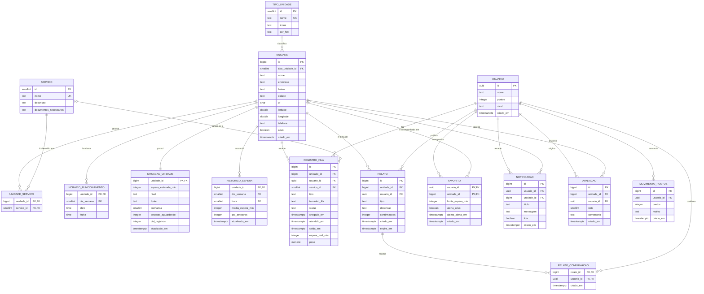

# Modelo de dados do Passa Rápido

## MER (modelo conceitual)

Entidades e relacionamentos, sem detalhes de implementação.

| Entidade | O que representa |
|---|---|
| Tipo de unidade | Categoria do local: UPA, pronto-socorro, UBS, Poupatempo, INSS, CRAS |
| Unidade | Local de atendimento presencial, com endereço e coordenadas |
| Serviço | Atendimento oferecido, com os documentos exigidos |
| Horário de funcionamento | Abertura e fechamento de uma unidade por dia da semana |
| Usuário | Cidadão que consulta e colabora; acumula pontos e nível de reputação |
| Registro de fila | Check-in ou observação de um usuário em uma unidade |
| Situação da unidade | Espera estimada atual de cada unidade, calculada pelo banco |
| Histórico de espera | Média de espera por unidade, dia da semana e hora |
| Relato | Aviso sobre a unidade: falta de médico, sistema fora do ar, entre outros |
| Confirmação de relato | Outro usuário confirmando que o relato procede |
| Favorito | Unidade acompanhada por um usuário, com limite para alerta |
| Notificação | Alerta gerado pelo banco para um usuário |
| Avaliação | Nota de 1 a 5 de um usuário para uma unidade |
| Movimento de pontos | Extrato de pontos ganhos por colaboração |

Relacionamentos e cardinalidades:

- Um **tipo de unidade** classifica muitas **unidades** (1:N).
- Uma **unidade** oferece muitos **serviços**, e um serviço é oferecido em muitas unidades (N:N, resolvido por `unidade_servico`).
- Uma **unidade** tem até sete **horários de funcionamento**, um por dia da semana (1:N).
- Uma **unidade** tem exatamente uma **situação** (1:1) e muitas linhas de **histórico de espera** (1:N).
- Um **usuário** faz muitos **registros de fila**, e cada registro pertence a uma unidade (N:1 para os dois lados).
- Um **registro de fila** pode indicar um **serviço** (N:1, opcional).
- Um **usuário** publica muitos **relatos** sobre unidades; um relato recebe muitas **confirmações**, uma por usuário (N:N entre relato e usuário, resolvido por `relato_confirmacao`).
- Um **usuário** favorita muitas **unidades** e uma unidade é favoritada por muitos usuários (N:N, resolvido por `favorito`).
- Um **usuário** recebe muitas **notificações**, cada uma sobre uma unidade (1:N).
- Um **usuário** avalia cada **unidade** no máximo uma vez (N:N com atributo, resolvido por `avaliacao`).
- Um **usuário** tem muitos **movimentos de pontos** (1:N).

## DER (modelo lógico)

## Rotinas de automação

| Rotina | Tipo | O que automatiza |
|---|---|---|
| `prc_recalcular_situacao` | Procedure | Espera estimada da unidade por média ponderada (reputação, espera medida e idade do registro), com histórico como reserva |
| `prc_expirar_registros` | Procedure com cursor e tratamento de erro | Encerra check-ins esquecidos e atualiza todas as unidades |
| `prc_consolidar_historico` | Procedure | Médias por unidade, dia da semana e hora |
| `fn_melhor_horario` | Function | Previsão de espera por hora e marcação do melhor horário |
| `fn_recomendar_unidades` | Function | Unidades próximas ordenadas por deslocamento mais espera |
| `fn_confirmar_relato` | Function com exceções próprias | Confirmação de relato com validações |
| `fn_painel_geral` | Function | Indicadores gerais do painel |
| `fn_distancia_km`, `fn_unidade_aberta`, `fn_peso_usuario` e auxiliares | Functions | Distância, horário de funcionamento e reputação |
| `trg_registro_antes_inserir` | Trigger | Bloqueia registro repetido, aplica o peso do usuário e encerra a fila anterior |
| `trg_registro_antes_atualizar` | Trigger | Calcula a espera real ao marcar o atendimento |
| `trg_registro_depois` | Trigger | Recalcula a unidade e credita pontos |
| `trg_pontos_atualiza_usuario` | Trigger | Atualiza saldo e nível de reputação |
| `trg_situacao_alerta_favoritos` | Trigger | Gera notificação quando a fila cai abaixo do limite do favorito |
| `trg_confirmacao_relato`, `trg_relato_pontos`, `trg_avaliacao_pontos` | Triggers | Contador, validade e pontuação de relatos e avaliações |
| `vw_mapa_unidades`, `vw_indicadores_unidade`, `vw_ranking_colaboradores` | Views | Dados prontos para o mapa, o painel e o ranking |

Os testes das rotinas estão em `database/tests/test_rotinas.sql`.
