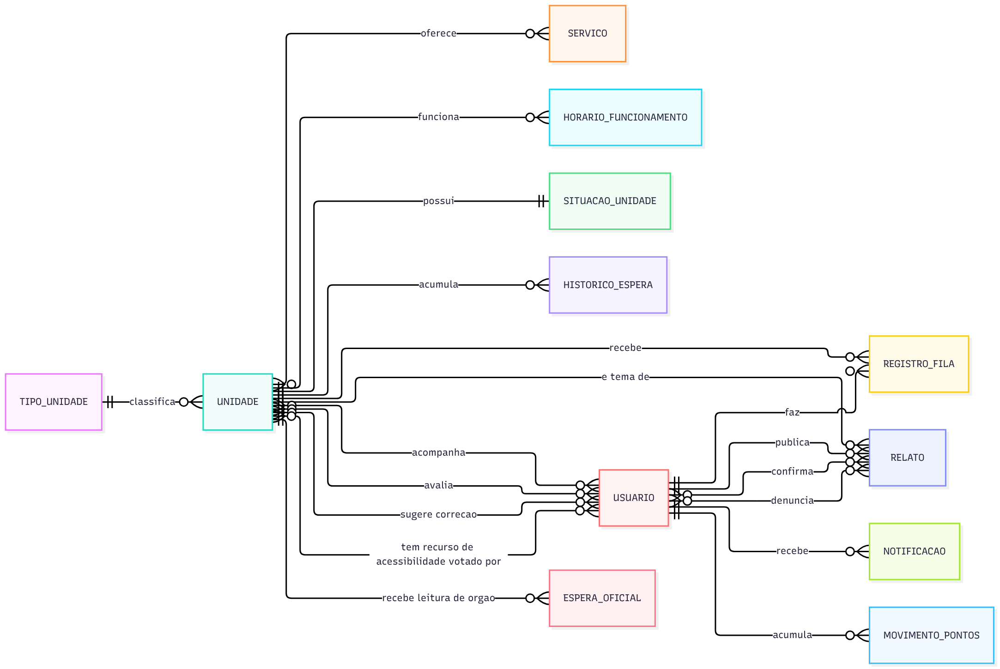
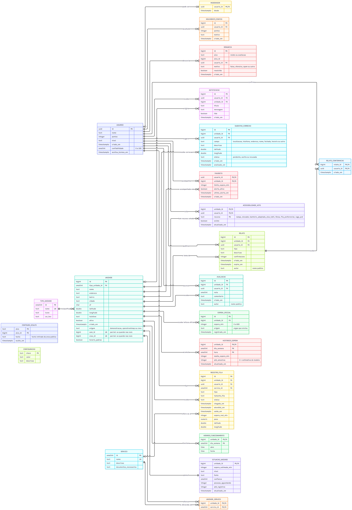

# Modelo de dados

PostgreSQL (Supabase). Os scripts estão em `database/`, numerados na ordem de aplicação (01 a 14). Os diagramas são
`mer.png` (conceitual) e `der.png` (lógico), com versão `.svg` ampliável e fonte Mermaid em `diagramas/`.

## MER (modelo conceitual)

| Entidade | Representa |
|---|---|
| Tipo de unidade | UPA, Pronto-socorro, UBS, Poupatempo, INSS ou CRAS |
| Unidade | Local de atendimento: endereço, coordenadas, origem do cadastro (CNES, OpenStreetMap) e se o horário é o padrão do tipo |
| Serviço | Atendimento oferecido (Pediatria, CNH...) e documentos exigidos |
| Horário de funcionamento | Abre e fecha de uma unidade por dia da semana |
| Usuário | Cidadão que consulta e colabora: pontos, nível, confiabilidade, aceite dos termos |
| Registro de fila | Check-in (na fila) ou observação (retrato do momento) em uma unidade |
| Situação da unidade | Espera atual calculada pelo banco; é a tabela que o app assina em tempo real |
| Histórico de espera | Média por unidade, dia da semana e hora; base da previsão |
| Relato, confirmação | Aviso sobre a unidade, com validade, e a confirmação por outras pessoas |
| Favorito, notificação | Unidade acompanhada com limite de espera, e o alerta gerado |
| Avaliação | Nota de 1 a 5 e comentário opcional |
| Movimento de pontos | Extrato dos pontos ganhos |
| Sugestão de correção | Pedido de ajuste nos dados de uma unidade, analisado depois |
| Acessibilidade (voto) | "Tem" ou "não tem" para rampa, elevador, banheiro adaptado, piso tátil, Libras, fila preferencial, vaga PcD |
| Denúncia, conteúdo oculto | Denúncia de aviso ou avaliação e o texto retirado da área pública |
| Espera oficial | Leitura de espera enviada por órgão conveniado |
| Moderador, configuração | Quem modera; chaves de funcionamento (limites, consenso, validação de localização) |

Cardinalidades principais: tipo 1:N unidade; unidade N:N serviço (`unidade_servico`); unidade 1:N horário; unidade 1:1
situação e 1:N histórico; usuário 1:N registro; relato N:N usuário (`relato_confirmacao`); usuário N:N unidade por
`favorito`, `avaliacao` e `acessibilidade_voto`.

## DER (modelo lógico)

22 tabelas. Chaves primárias, estrangeiras e tipos estão no diagrama; as restrições mais relevantes:

| Restrição | Onde | Efeito |
|---|---|---|
| `check` de domínio | `registro_fila.tamanho_fila`, `situacao_unidade.nivel` e `fonte`, `relato.tipo`, `sugestao_correcao.campo`, `denuncia.motivo` | Só aceita os valores previstos |
| `check (nota between 1 and 5)`, `confiabilidade between 0 and 100`, `espera_min between 0 and 600` | avaliação, usuário, espera oficial | Limites de valor |
| Chaves compostas | `unidade_servico`, `horario_funcionamento`, `historico_espera`, `relato_confirmacao`, `favorito`, `acessibilidade_voto` | Uma linha por combinação |
| Únicos parciais | `uq_unidade_osm_id`, `uq_unidade_cnes_id` (`where ... is not null`) | Evitam importar a mesma unidade duas vezes |
| Índices parciais e por data | `idx_unidade_tipo where ativo`, `idx_registro_aguardando where status = 'aguardando'`, `idx_registro_unidade_chegada`, `idx_relato_unidade_expira` | Consultas só nas linhas que importam |
| `on delete cascade` | filhos de `usuario` e de `unidade` | Excluir a conta apaga os dados pessoais |

## Rotinas de automação

Escritas em PL/pgSQL: 31 funções, 7 procedures, 19 gatilhos e 8 views. Descrição de cada uma em
`descricao-de-classes-e-metodos.md`.

| Grupo | Rotinas |
|---|---|
| Cálculo da fila | `prc_recalcular_situacao` (média ponderada dos registros das últimas 2 h, peso do usuário, decaimento no tempo; dado oficial vale mais), `fn_minutos_por_tamanho`, `fn_nivel_por_minutos`, `fn_peso_usuario` |
| Manutenção agendada (pg_cron) | `prc_expirar_registros` (a cada 10 min, cursor e exceção por unidade), `prc_consolidar_historico` (diária) |
| Previsão e busca | `fn_melhor_horario`, `fn_recomendar_unidades`, `fn_distancia_km`, `fn_unidade_aberta` |
| Colaboração | gatilhos de registro, relato, avaliação e pontos; `fn_confirmar_relato`; `trg_situacao_alerta_favoritos` (alerta de fila baixa) |
| Moderação e confiança | `fn_listar_sugestoes_pendentes`, `fn_analisar_sugestao`, denúncias e ocultação automática, consenso de localização |
| Dado oficial | `fn_registrar_espera_oficial`, `fn_registrar_esperas_oficiais` (só com chave de serviço) |
| Privacidade | `fn_nome_publico`, `excluir_minha_conta`, `vw_relato_publico`, `vw_avaliacao_publica` |
| Indicadores | `fn_painel_geral`, `fn_meu_impacto`, `vw_mapa_unidades`, `vw_indicadores_unidade`, `vw_gestao_regiao`, `vw_ranking_colaboradores` |

## Segurança por linha

Todas as tabelas têm RLS ligado. O aplicativo usa só a chave pública; o que cada papel pode fazer está no banco.

| Dado | Leitura | Gravação |
|---|---|---|
| Unidades, serviços, horários, situação, histórico | Qualquer pessoa | Só rotinas do banco |
| Avisos e avaliações | Qualquer pessoa, por visões sem o identificador do autor | Usuário autenticado, autor fixado pelo banco |
| Perfil, registros, favoritos, notificações, pontos | Só o dono | O dono, em colunas liberadas; pontos, peso e situação nunca |
| Denúncias, texto oculto, moderadores, espera oficial | Ninguém pelo app | Denúncia: o autor; demais: servidor |
| Moderação | Só quem está em `moderador`, conferido em cada chamada | Idem |

Mais em `seguranca-e-privacidade.md`.

## Testes do banco

| Arquivo | Verificações | Cobre |
|---|---|---|
| `tests/test_rotinas.sql` | 19 | situação, check-in, repetição, atendimento, níveis, alerta, expiração, recomendação, melhor horário |
| `tests/test_regras_09.sql` | 21 | nome público, limites por hora, validação de localização, confiabilidade, exclusão de conta |
| `tests/test_sugestoes_13.sql` | 18 | sugestões de correção e análise |
| `tests/test_melhorias_14.sql` | 69 | dado oficial, acessibilidade, denúncias, moderação, consenso, privacidade, permissões e RLS |

Cada arquivo roda numa transação e desfaz tudo ao final.
